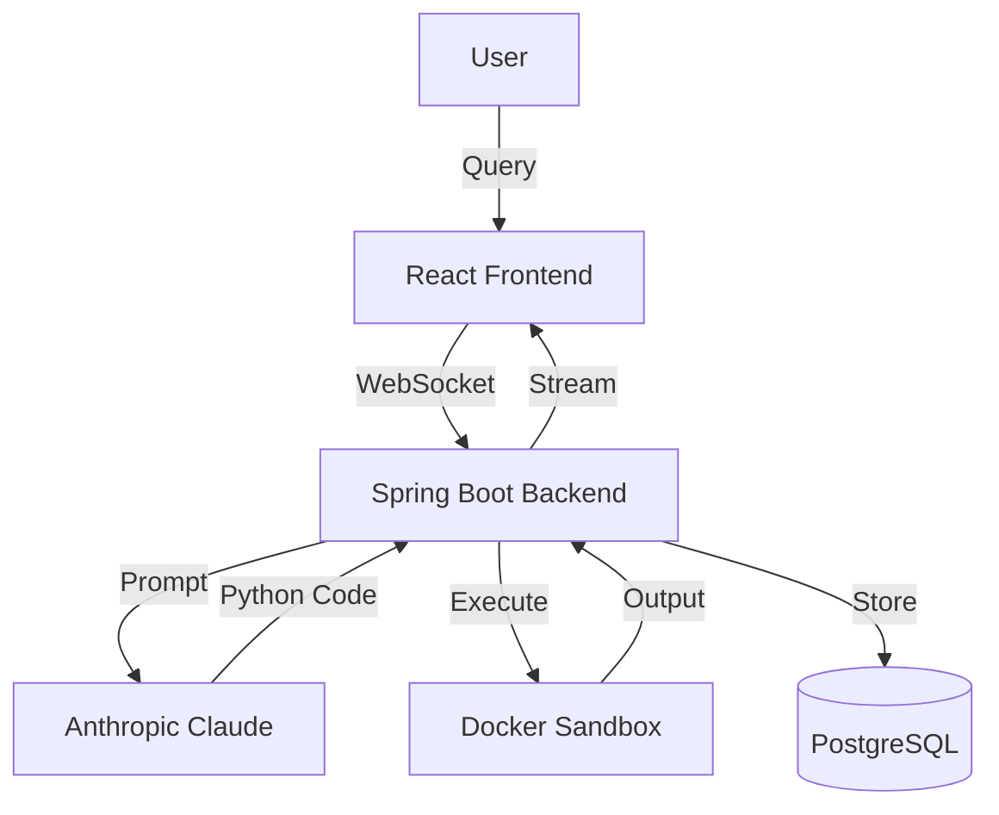

# MY Manus - AI Agent Platform with CodeAct Architecture

> A transparent AI agent platform where agents write and execute Python code to solve complex tasks, inspired by Manus AI's interface and powered by CodeAct architecture.


## 🎯 What is MY Manus?

MY Manus is a self-hosted implementation of an autonomous AI agent platform built on the CodeAct architecture. Unlike traditional agent systems that rely on rigid API calls, MY Manus agents write and execute Python code to accomplish tasks, providing complete transparency through real-time visualization of their work.

### Key Features

- **🧠 CodeAct Architecture**: Agents write Python code instead of emitting JSON tool calls (the [CodeAct paper](https://arxiv.org/abs/2402.01030) reports up to 20% higher success rates than JSON/text actions on its benchmarks; this project has not been benchmarked independently)
- **👁️ Transparent Execution**: Multi-panel interface with real-time visualization (Chat, Terminal, Editor, Browser, Events, Files, Replay, Knowledge, Plan)
- **🔒 Secure Sandboxing**: Code runs in Docker containers with memory/CPU/time limits and networking disabled by default (a `host` mode exists for local development)
- **🔧 Extensible Tools**: Built-in file, shell, browser, web search, todo, messaging, and visualization tools, plus dynamic MCP tool discovery
- **💾 State Persistence**: Variables and context persist between code executions
- **🔐 Auth Toggle**: `AUTH_ENABLED=true` makes Spring Security require authentication on all API routes except `/ws/**` and `/api/health` (off by default; JWT token issuance/validation is not wired up yet)
- **🎬 Session Replay**: Record and replay agent sessions step by step
- **🧠 RAG/Knowledge Base**: Upload documents for semantic search and context augmentation
- **🌐 Enhanced Browser**: Multi-tab browsing with console logs and network monitoring
- **🔔 Real-Time Notifications**: Browser notifications and in-app notification center with priority levels
- **📋 Live Plan Visualization**: Real-time task tracking synchronized with todo.md files
- **💬 Multi-Turn Conversations**: Intelligent LLM-based message classification for parallel query handling
- **📊 Observability**: Prometheus metrics via Spring Boot Actuator / Micrometer

## 🏗️ Architecture Overview



## 🚀 Quick Start

### Prerequisites

- Java 17+
- Node.js 22+
- Docker (for the code sandbox and, optionally, PostgreSQL)
- An Anthropic API key

### Installation

1. **Clone the repository**
```bash
git clone https://github.com/maheshyaddanapudi/MY-Manus.git
cd MY-Manus
```

2. **Build the sandbox image** (one-time; the backend runs code in `mymanus-sandbox:latest`)
```bash
./scripts/build-sandbox.sh
```
For quick local experiments you can skip this and set `SANDBOX_MODE=host`, which runs agent code directly on your machine — only do that in a trusted environment.

3. **Start PostgreSQL** (needed for the default profile; the `dev` profile below uses an in-memory H2 database instead)
```bash
docker run -d \
  --name mymanus-db \
  -e POSTGRES_DB=mymanus \
  -e POSTGRES_USER=mymanus \
  -e POSTGRES_PASSWORD=mymanus \
  -p 5432:5432 \
  postgres:15
```

4. **Configure environment**
```bash
# Backend configuration
cp backend/.env.example backend/.env
# Edit backend/.env with your API keys

# Frontend configuration
cp frontend/.env.example frontend/.env
```

5. **Run the backend** (`dev` = in-memory H2; omit the profile to use PostgreSQL)
```bash
cd backend
./mvnw spring-boot:run -Dspring.profiles.active=dev
```

6. **Run the frontend**
```bash
cd frontend
npm install
npm run dev
```

7. **Access the application**
- Frontend: http://localhost:5173 (Vite dev server; proxies `/api` and `/ws` to the backend)
- Backend API: http://localhost:8080
- Swagger UI: http://localhost:8080/swagger-ui.html

## 🎮 Usage

### Basic Interaction

1. **Ask the agent to solve a problem**
```
"Analyze the sentiment of recent news about AI and create a visualization"
```

2. **Watch the agent work**
   - See Python code being written in the Editor panel
   - Observe execution in the Terminal panel
   - View results and visualizations in the Browser panel

3. **Agent writes code like**
```python
# Agent's generated code appears here
import requests
from textblob import TextBlob
import matplotlib.pyplot as plt

# Fetch news data
news = fetch_ai_news()

# Analyze sentiment
sentiments = []
for article in news:
    blob = TextBlob(article['title'])
    sentiments.append(blob.sentiment.polarity)

# Create visualization
plt.figure(figsize=(10, 6))
plt.hist(sentiments, bins=20)
plt.title('AI News Sentiment Distribution')
plt.xlabel('Sentiment Score')
plt.ylabel('Frequency')
plt.savefig('sentiment_analysis.png')
print("Analysis complete! Saved visualization.")
```

## 🛠️ Core Components

### Backend (Spring Boot)
- **CodeActAgentService**: Orchestrates the agent loop
- **PythonSandboxExecutor**: Secure code execution
- **ToolRegistry**: Manages available tools
- **WebSocketController**: Real-time updates

### Frontend (React + TypeScript)
- **ChatPanel**: Conversation interface
- **TerminalView**: Command execution display
- **EditorView**: Code editing with Monaco
- **BrowserView**: Web content rendering

### Sandbox (Docker)
- Ubuntu 22.04 base image
- Python 3.11 with data science stack
- Node.js 22.13 for JavaScript tools
- FFmpeg, Poppler for media processing
- Network disabled by default (`network-mode: none`)

## 🔧 Configuration

### Profiles
- default (`application.yml`): PostgreSQL, Docker sandbox
- `dev` (`application-dev.yml`): in-memory H2 database
- `dev-local` (`application-dev-local.yml`): file-based H2 and host-mode sandbox

### Authentication (work in progress)
```yaml
# application.yml (set via environment variables)
auth:
  enabled: ${AUTH_ENABLED:false}
  jwt:
    secret: ${JWT_SECRET}
```
With `auth.enabled=true`, Spring Security rejects unauthenticated requests, but no login or JWT filter is implemented yet, so this is a lock-down switch rather than a working login flow.

## 📚 Documentation

### 🚀 Getting Started
- **[QUICKSTART.md](QUICKSTART.md)** - Get started in 5 minutes
- **[SETUP.md](SETUP.md)** - Detailed installation and configuration
- **[Development Guide](docs/guides/DEVELOPMENT_GUIDE.md)** - Complete developer onboarding (prerequisites → first contribution)
  - Installation, setup, testing, debugging, contributing
  - Adding new tools, endpoints, UI panels with examples
  - First contribution ideas (easy → advanced)
- **[Project Overview](docs/PROJECT_OVERVIEW.md)** - Project need, inspiration, vision, and design philosophy
  - Why MY-Manus exists, Manus AI inspiration, design philosophy

### 🏗️ Architecture & Design
- **[System Architecture](docs/architecture/ARCHITECTURE.md)** - Complete system architecture with 10+ diagrams
  - Component architecture, data flow, deployment models
  - Security architecture (5 layers)
  - Performance optimizations, caching strategies
  - MY-Manus vs Manus AI detailed comparison
- **[Database Schema](docs/architecture/DATABASE_SCHEMA.md)** - Full ERD and schema documentation for all 9 tables
  - Complete ERD diagrams with relationships
  - JSONB usage patterns and examples
  - Indexes, performance considerations, query examples
- **[Event Stream Guide](docs/architecture/EVENT_STREAM_GUIDE.md)** - Deep dive into event stream architecture
  - All 7 event types documented with code examples
  - Implementation patterns and best practices
  - Debugging with events, performance considerations
- **[Frontend Architecture](docs/architecture/FRONTEND_ARCHITECTURE.md)** - React components, state management, WebSocket integration
  - Eight-panel UI architecture (Chat, Terminal, Editor, Browser, Events, Files, Replay, Knowledge, Plan)
  - Zustand store patterns, real-time event streaming
- **[Sandbox Architecture](docs/architecture/SANDBOX_ARCHITECTURE.md)** - Docker sandbox design and security

### 🔥 Advanced Features
- **[Multi-Turn Conversations](docs/guides/MULTI_TURN_SCENARIOS.md)** - TASK/QUERY/ADJUSTMENT classification
  - Real-world examples with flow diagrams (5 scenarios)
  - LLM-based classification logic implementation
  - Edge cases and best practices
- **[Observability](docs/guides/OBSERVABILITY.md)** - Prometheus/Grafana monitoring setup
  - Complete metrics documentation (JVM, HTTP, DB, Spring AI, custom business metrics)
  - PromQL query examples for common scenarios
  - Example Grafana dashboard configurations
  - Alerting rules and troubleshooting guide
- **[API Reference](docs/guides/API_REFERENCE.md)** - Complete REST and WebSocket API documentation
  - All 40+ REST endpoints documented with examples
  - All 6 WebSocket topics with subscription examples
  - Request/response formats, error handling, rate limiting

### 📖 Implementation Guides
- **[Agent Guide](docs/guides/AGENT_GUIDE.md)** - CodeAct implementation details
- **[UI Guide](docs/guides/UI_GUIDE.md)** - Frontend development patterns
- **[Sandbox Guide](docs/guides/SANDBOX_GUIDE.md)** - Environment setup and configuration
- **[Tools Guide](docs/guides/TOOLS_GUIDE.md)** - Adding and customizing tools
- **[Deployment Guide](docs/guides/DEPLOYMENT.md)** - Production deployment strategies

### 📊 Project Status
- **[Final Summary](docs/project/FINAL_SUMMARY.md)** - Complete differential analysis
- **[Differential Analysis](docs/project/DIFFERENTIAL_ANALYSIS.md)** - Comparison with Manus AI

### 🔬 Research
- **[Manus AI Research Report](docs/research/MANUS_AI_RESEARCH_REPORT.md)** - Original research and analysis

## 🧪 Testing

```bash
# Backend tests
cd backend
./mvnw test

# Frontend tests
cd frontend
npm test
```

## 🚢 Deployment

### Docker Compose (Development)
```bash
docker-compose up -d
```
Starts PostgreSQL (5432), the backend (8080), and the frontend dev server. Build the sandbox image first (`./scripts/build-sandbox.sh`). The backend container mounts the host Docker socket to launch sandboxes.

> Note: the frontend container runs `vite --host`, which listens on Vite's default port 5173, while Compose publishes port 3000. Until that mapping is aligned, run the frontend natively (`npm run dev`) or adjust the port.

Kubernetes manifests are not included; see [Deployment Guide](docs/guides/DEPLOYMENT.md) for options.

### Environment Variables
```bash
DB_HOST=localhost
DB_PORT=5432
DB_NAME=mymanus
DB_USER=mymanus
DB_PASSWORD=mymanus
ANTHROPIC_API_KEY=your-key-here
AUTH_ENABLED=false  # true locks down the API (JWT login not yet implemented)
JWT_SECRET=your-secret-here
SANDBOX_MODE=docker # or host (trusted local development only)
```

## 🤝 Contributing

Issues and pull requests are welcome.

### Development Workflow
1. Fork the repository
2. Create a feature branch
3. Make your changes
4. Add tests
5. Submit a pull request

## ⚙️ Default Limits

These are configured defaults (`backend/src/main/resources/application.yml`), not measured benchmarks:

- **Sandbox memory**: 512 MB per container
- **Sandbox CPU**: 50% of one core
- **Code execution timeout**: 30 seconds
- **Agent loop**: up to 20 iterations per task

## 🔐 Security

- Agent code runs in Docker containers with CPU, memory, and time limits and no network by default
- `host` sandbox mode bypasses container isolation — use only for trusted local development
- Authentication is disabled by default; `AUTH_ENABLED=true` locks down the API, but JWT login is not implemented yet
- The backend needs access to the Docker socket to launch sandboxes, so treat the backend host as privileged

## 🙏 Acknowledgments

- Inspired by [Manus AI](https://manus.im) interface design
- CodeAct architecture from [ICML 2024 paper](https://arxiv.org/abs/2402.01030)
- Built with Spring Boot, React, Docker, and PostgreSQL
- Powered by Anthropic Claude via Spring AI

## 📄 License

No license file is included yet; all rights reserved unless a license is added.

## 💬 Support

- **Documentation**: [docs/](docs/)
- **Issues**: [GitHub Issues](https://github.com/maheshyaddanapudi/MY-Manus/issues)

## 🌟 Star History

If you find MY Manus useful, please consider giving it a star! ⭐

---

**MY Manus** - Where AI agents write code to solve your problems transparently.
